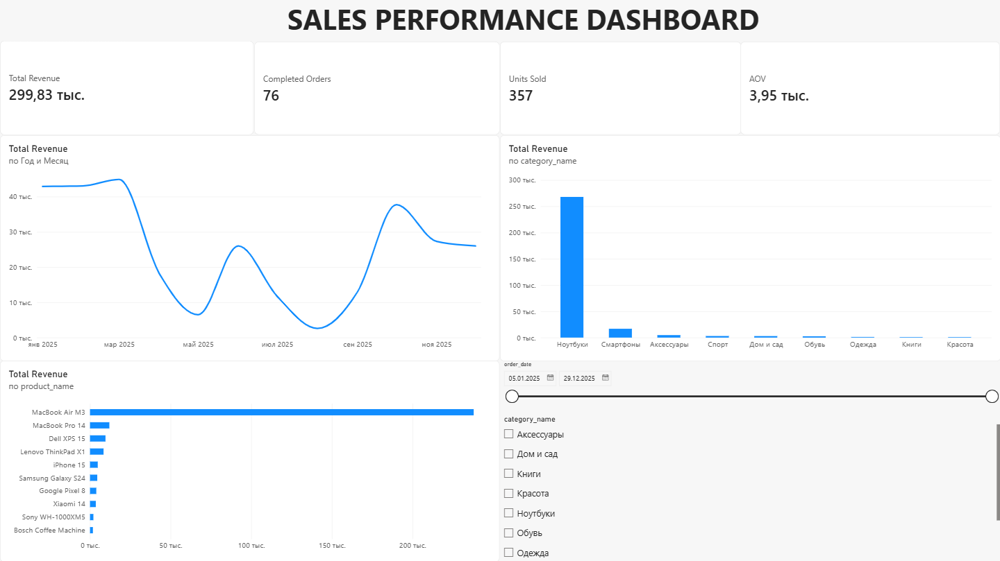

# Sales Analysis

## Project Overview

This project focuses on analyzing sales data using SQL and Power BI. The goal is to evaluate business performance, identify revenue trends, and understand product and customer behavior.

The project includes SQL-based analysis and an interactive Power BI dashboard built on a PostgreSQL database.

## Tools & Technologies

- **PostgreSQL** — data storage and SQL analysis
- **SQL** — data aggregation, filtering, joins, CTEs, and window functions
- **Power BI** — interactive dashboard and data visualization

## Database Structure

The database contains the following tables:

| Table | Description |
|---|---|
| `customers` | Customer information |
| `orders` | Order details and statuses |
| `order_items` | Products, quantities, and prices within orders |
| `products` | Product information |
| `categories` | Product categories |

Revenue is calculated using the quantity and purchase price of each order item. Only orders with the `completed` status are included in completed-sales metrics.

## SQL Analysis

The SQL analysis is organized into four sections:

### 1. Sales Analysis
- Total revenue
- Number of completed orders
- Units sold
- Average order value (AOV)
- Monthly revenue trends

### 2. Product Analysis
- Revenue by product and category
- Units sold by category
- Top-performing products
- Product contribution to total revenue

### 3. Customer Analysis
- Revenue and order count by customer
- Average order value by customer
- Customer revenue ranking
- Repeat customer analysis
- Customer segmentation

### 4. Advanced Analysis
- Monthly revenue growth
- Monthly completed-order growth
- Moving average of revenue
- Customer and product rankings
- Revenue contribution analysis

SQL queries are available in the [`sql`](sql/) directory.

## Power BI Dashboard

The interactive dashboard provides an overview of sales performance, including:

- Total Revenue
- Completed Orders
- Units Sold
- Average Order Value (AOV)
- Monthly revenue trend
- Revenue by product category
- Top 10 products by revenue
- Date and category slicers

### Dashboard Preview



The Power BI report is available in the [`powerbi`](powerbi/) directory.

## Repository Structure

```text
sales-analysis/
├── README.md
├── powerbi/
│   └── Sales_Analysis_Dashboard.pbix
├── screenshots/
│   └── dashboard.png
└── sql/
    ├── 01_sales_analysis.sql
    ├── 02_product_analysis.sql
    ├── 03_customer_analysis.sql
    └── 04_advanced_analysis.sql
```

## Key Takeaways

This project demonstrates the ability to:

- Write SQL queries for business analysis
- Join and aggregate data from multiple tables
- Use CTEs and window functions
- Calculate key sales performance metrics
- Build an interactive Power BI dashboard
- Present analytical results in a structured format

## Data Disclaimer

The dataset used in this project is synthetic and was created for educational and portfolio purposes. It does not contain real customer or commercial data.
